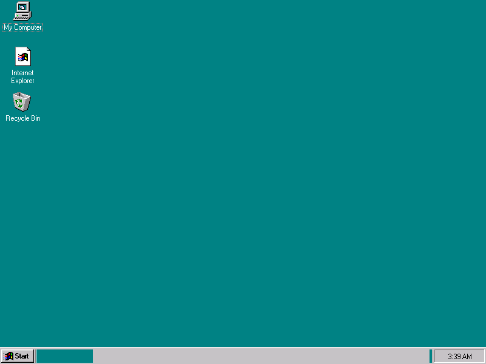
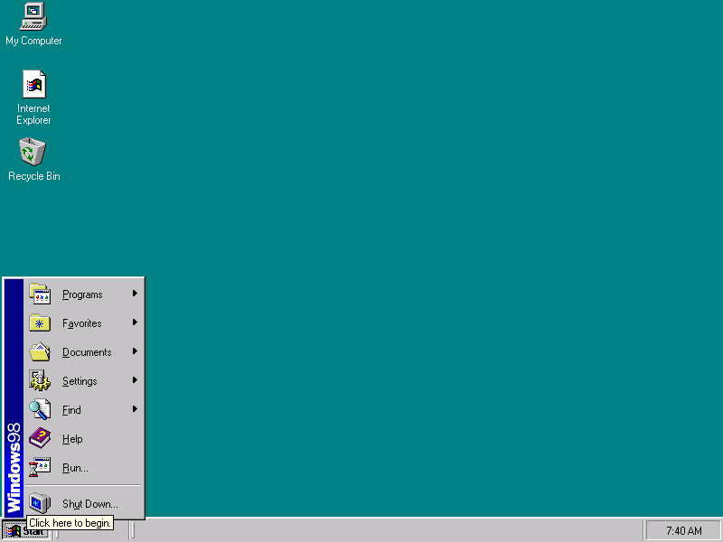
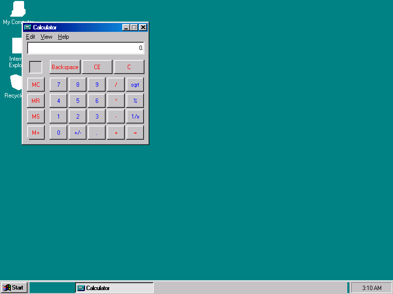
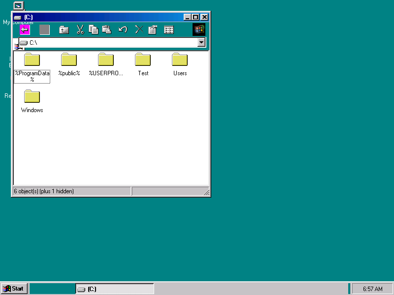
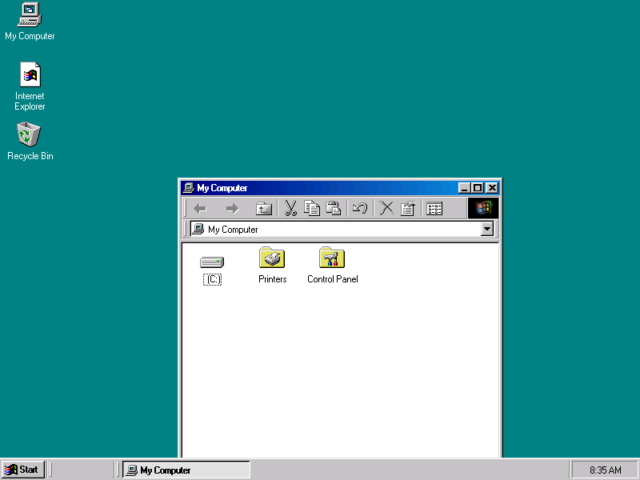

# win98-recomp

Windows 98 SE's own userland, statically recompiled with
[pcrecomp](https://github.com/sp00nznet/pcrecomp) and run on
a modern Windows host, with no emulator. Sister of win2000-recomp.

**This repository contains no Windows code or data.** Everything from your
copy (extracted CAB files, catalogs, lifted C) goes into the gitignored
`work/` and `src/gen/`.



| | |
|---|---|
|  |  |
| Explorer's Start menu | Start → Run → Calculator |
|  |  |
| My Computer → C: (the sandbox root) | Windows move, minimize and close |

Screenshots show the guest's own screen, drawn by Win98's USER/GDI through
pcrecomp's display driver stand-in.

How it works: [docs/architecture.md](docs/architecture.md).

## Status

**Done.** Win98 SE boots its own Explorer desktop here, with no emulator and no original code executed: the Start menu, Run, Notepad, Calculator, Solitaire and Minesweeper work, and My Computer opens and lists C: (work/root). Ten gates (`tools/check_{m1,w16,calc,sol,winmine,notepad,explorer,run,startprog,mycomp}.sh`) pass. Safety model: guest memory is never executable, the registry is boxed (whole keys never read the host), files stay in work/root, no host shell, muted, no devices. Known gaps (disabled toolbar images, grippers, Favorites, IE icon, calc keys 1/2, Win16 TDB+54) and how to run it are at the top of docs/survey.md.

| Stage | What | State |
|---|---|---|
| 1 | Survey of the kernel boundary (`tools/survey.py`) | VxDCall gate, flat-thunk tables, 16-bit int 21h/2Fh/31h mapped |
| 2 | PE accessories on native32 against host DLLs | calc and notepad run (winmine/sol/freecell are Win16 on 98) |
| 3 | console program on Win98's own kernel32 + vwin32 shim | milestone 1: `xcopy32 /?` prints its own help (exactly its string resources) and `xcopy32 C:\TEST\SRC C:\TEST\DST /S /I` copies a tree in the sandbox, byte-identical |
| 4 | GUI on lifted user32/gdi32 + USER.EXE/GDI.EXE via recomp16 | Win98 boots its own KRNL386/USER/GDI; calc (12+3= shows 15., `tools/check_calc.sh`) Solitaire (deal, clock: `tools/check_sol.sh`), Minesweeper (`tools/check_winmine.sh`) and Notepad (Win32, typing: `tools/check_notepad.sh`) run as the shell (W16_SHELL=) |
| 5 | Win98's Explorer as the shell | desktop, taskbar, Start menu, Run, Programs > Notepad/Solitaire (check_explorer, check_run, check_startprog); My Computer paints and opens C: (check_mycomp) |

## Getting Started

You need **your own copy of Windows 98 Second Edition**: its CD image, an
`.iso`. Nothing from Windows is in this repository or downloaded for you;
everything is extracted and built on your machine from your CD.

1. Download this repository (the green **Code** button, then **Download ZIP**)
   and unzip it, or `git clone` it, somewhere with 4 GB free.
2. Put your Windows 98 SE `.iso` in that folder (or give it with
   `Setup.cmd -Iso <path>`).
3. Double-click **`Setup.cmd`**. From Git Bash, `./setup.sh` does the same
   (`--iso FILE`, `--yes`, `--force`); it is Windows only, as the build is MSVC x86.
4. Start Windows 98 with **`Windows 98 (recomp).cmd`** in that folder.

The script asks before installing anything it needs (Python and its packages,
7-Zip, Visual Studio 2022's C++ Build Tools, CMake, Ninja, and pcrecomp beside
this folder, or where `PCRECOMP` points), then extracts the CD and its CABs,
seeds, lifts and builds, and fills the guest's registry box and C:\. The first
run takes about an hour (52 minutes measured, about 3 GB: extracting the CABs,
then the lift and the compile); a rerun skips every finished step (`-Force`
redoes them). Everything it does goes to `setup.log`.

## Building by hand

Visual Studio 2022 (x86 tools), CMake, Ninja, Python 3 with `capstone` and
`pefile` (and `pillow` for hiddenrun and the gates), 7-Zip, pcrecomp at `../pcrecomp`
(or `PCRECOMP`). `tools/setup.ps1` runs these steps in this order: extract the CD and CABs,
rebase, `py -3 tools\seeds.py` (every seed file named below), ne_link, the four lifts,
build.cmd, reginst, a first boot (to lay out work\root), then `startmenu.py`.

```
7z x -owork\cd <your Win98 SE .iso>
for %c in (work\cd\WIN98\*.CAB) do 7z e -y -owork\sys %c
py -3 tools\lift.py calc work\sys\calc.exe
py -3 tools\lift.py notepad work\sys\notepad.exe
build.cmd
set PCRECOMP_MUTE=1
py -3 tools\hiddenrun.py --secs 7 --shot 5 --out shots\calc -- build\calc.exe --mute
```

The guest's registry is boxed (pcrecomp regbox32) under
`HKCU\Software\pcrecomp\w98\<app>`.

xcopy32 on Win98's own lifted kernel32 (milestone 1):

```
py -3 tools\lift.py xcopy work\sys\xcopy32.mod work\sys\kernel32.dll
sh tools/run_xcopy.sh -- /?
sh tools/check_m1.sh        # /? against the string resources, then a /S /I copy
```

Milestone 2, chunk 1: the 16-bit modules in Win16 identity mode, called
through kernel32's own QT_Thunk:

```
set NE_IDENTITY_SEL=1
py -3 tools\w16_seeds.py work\sys > work\seeds\w16.json
py -3 ..\pcrecomp\tools\ne\ne_link.py --work work\w16 --seeds work\seeds\w16.json --shims ..\pcrecomp\runtime\win16\identity work\sys\KRNL386.EXE work\sys\GDI.EXE work\sys\USER.EXE work\sys\DDEML.DLL work\sys\MSGSRV32.EXE work\sys\shell.new work\sys\kommctrl.dll work\sys\winmine.exe work\sys\sol.exe work\sys\cards.dll
(shell.new and kommctrl.dll are what setup installs as SHELL.DLL and COMMCTRL.DLL, per shell.inf/subase.inf; k32host copies them into work\root under those names)
py -3 tools\lift.py w16test work\sys\xcopy32.mod work\sys\kernel32.dll work\sys\gdi32.dll work\sys\advapi32.dll work\sys\user32.dll work\sys\mpr.dll work\sys\mprexe.exe work\sys\mprserv.dll work\sys\mspwl32.dll work\sys\calc.exe work\sys\msvcrt.dll work\sys\shlwapi.dll work\sys\comctl32.dll work\sys\shell32.dll work\rebased\notepad_1100.exe work\sys\comdlg32.dll work\rebased\explorer_1400.exe work\sys\shdocvw.dll work\rebased\ole32.dll work\sys\browseui.dll work\sys\shdoc401.dll
(Explorer: rebase.py ... explorer.exe=0x01400000, renamed explorer_1400.exe, and ole32.dll=0x7F400000 (its own base
runs into the host's 0x7FFE0000 page); seeds first: py -3 tools\vtseeds.py <module> work\seeds\<file>.json for
work\rebased\ole32.dll, work\sys\shdocvw.dll, work\sys\shell32.dll, work\rebased\explorer_1400.exe, work\sys\browseui.dll; the registry box:
py -3 tools\reginst.py w98\xcopy; then set W16_SHELL=Explorer.exe)
(first: py -3 ..\pcrecomp\tools\pe\rebase.py work\sys work\rebased notepad.exe=0x01100000, then rename it notepad_1100.exe)
(build.cmd links each lifted module as its own DLL next to the exe, build\w16test_<module>.dll,
at fixed bases above 2 GB: one image of the whole lift no longer started; pcrecomp_gen_parts)
sh tools/check_w16.sh
set W16_LIBMAIN=KERNEL & build\w16test.exe --mute    (KRNL386 boots; W16_TRACE=1, W16_FN=2 for detail)
set HIDDENRUN_DESKTOP=pcrecomp_w98 & set W16_WINDOW=1 & set W16_INPUT=key 1@40;key 2@41;key +@42;key 3@43;key =@44
py -3 tools\hiddenrun.py --secs 52 --shot 50 --out out\calc -- build\w16test.exe --mute    (calc on Win98's own USER/GDI shows 15.; "click X,Y@T" clicks)
```

The guest's C:\ is `work/root`. Its console is the host's stdout, and its
hard errors (kernel32's USER32!MessageBoxA) are logged, never shown.

## License

MIT (LICENSE). Windows 98 is Microsoft's; bring your own copy.
